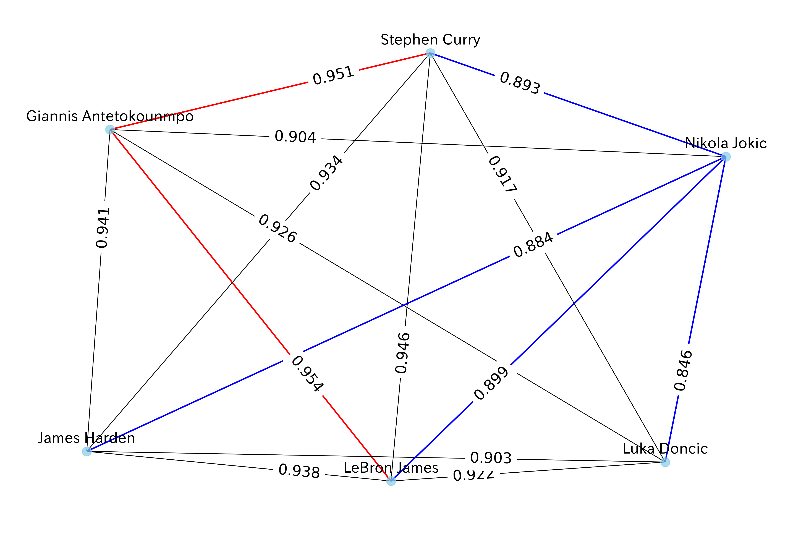
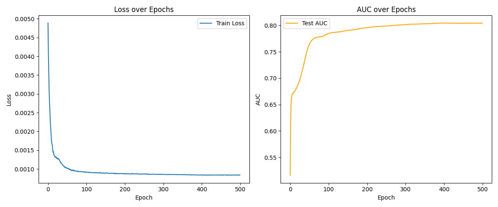

# NBA Network

[](https://opensource.org/licenses/Apache-2.0)
<a target="_blank" href="https://cookiecutter-data-science.drivendata.org/">
    
</a>

NBA Network Analysis and Machine Learning.  
e.g. train the relationships between players and predict the chemistry between players who have never been teammates.


## Blog
- [dev.to](https://dev.to/seaturt1e/predicting-nba-player-chemistry-using-graph-neural-networks-2j2f)
- [Zenn](https://zenn.dev/sea_turt1e/articles/2410af8823e6bd) *Japanese only

## Environment
Supported Python versions (these releases include the fix for the [eMudhra CA incident](https://emudhra.we-have-a-problem.com/)):

| Python | Status |
| --- | --- |
| 3.14.9 | Recommended (the pinned `requirements.txt` is tested with this version) |
| 3.13.17 | Supported |
| 3.15.1 | Supported by nbanetwork, but PyTorch does not yet publish Python 3.15 wheels for macOS (Linux/Windows wheels exist only on the PyTorch index) |

Importing `nbanetwork` emits a `UserWarning` when it runs on any other Python version. Newer patch releases of the same series (e.g. 3.14.10) are also accepted.

## Installation
```
# e.g. with pyenv
pyenv install 3.14.9
pyenv virtualenv 3.14.9 nbanetwork
pyenv local nbanetwork

pip install -U "pip>=26.2.2"
pip install -r requirements.txt
pip install -e .
```

If you already have an environment on an older Python (e.g. 3.12), recreate it on one of the supported versions above. Upgrading the packages alone is not enough.

## Security: eMudhra intermediate CA compromise (October 2026)
The private keys of eight eMudhra intermediate CA certificates were compromised ([details](https://emudhra.we-have-a-problem.com/)). Clients that ship their own CA bundle, such as Python's `certifi`, could trust certificates forged with these keys. This project addresses it as follows:

- **Python**: supported versions are 3.15.1 / 3.14.9 / 3.13.17 (see [Environment](#environment)). `requires-python` in `pyproject.toml` is now `>=3.13`, and importing `nbanetwork` warns on any other version.
- **certifi**: updated from `2024.8.30` to `2026.10.23` in `requirements.txt`. `sagemaker_inference/code/requirements.txt` now requires `certifi>=2026.10.19`. The new bundle no longer contains the affected roots (`AAA Certificate Services`, `emSign ECC Root CA - G3`).
- **pip / uv**: use pip `>=26.2.2` and uv `>=0.13.5`. `make requirements` already upgrades pip.
- **Dependencies**: packages without wheels for Python 3.14 were upgraded, including `torch` 2.11.0, `torch-geometric` 2.8.1 (2.6.1 fails on Python 3.14), `numpy` 2.5.4 and `pandas` 2.3.3. The `-e git+ssh://...` line, which installed an old commit of this repository over SSH, was removed from `requirements.txt`. Use `pip install -e .` instead.
- **GitHub Actions**: this repository has no workflows. If you add one that publishes to PyPI, use `pypa/gh-action-pypi-publish` `>=1.14.3`, pin every action by full commit SHA, and keep `permissions:` minimal.
- **SageMaker**: the Python version of the inference container is set by the SageMaker framework image, not by this repository. Use an image that ships one of the supported Python versions.

You can check that your environment no longer trusts the affected roots:
```
python -c "import certifi; b=open(certifi.where()).read(); print(certifi.__version__, 'emSign ECC Root CA - G3' in b)"
# expected: 2026.10.23 False
```

## Players Chemistry Network
Predict players who have never been on the same team before and have good chemistry.

### pipeline script
You can run the pipeline script.
```
sh scripts/player_chemistry/pipeline_player_chemistry_by_assist.sh
```

### pipeline steps
- download the data
- preprocess the data
- train the model
- visiualize the network of common players who have good chemistry.

### network visualization
You will get the image of the network visualization of the players who have good chemistry like below.  

  

Description:
- player nodes: playerName_hisDraftYear_hisDraftPick
- <span style="color: red; ">Red edges</span>: players who could have high chemistry.
- black edges: players who could have medium chemistry.
- <span style="color:#0066FF;">Blue edges</span>: players who could have low chemistry.

### Curve of the loss and AUC


#### Caution
The default graph visualization uses the model saved at `models/gnn_model_assist_best.pth`.  
It might result in an overfitted model or underfitted model.  
You can change the model by changing the model path in the script.
Also, you can change the threshold of the edge color by changing the threshold value in the script.  
(threshold_high: 0.90, threshold_low: 0.85. threshold values are between 0 and 1.)
```
sh scripts/player_chemistry/plot/plot_common_player_relation_network_by_assist.sh \
--model-path models/gnn_model_assist_{num_epoch}.pth \
--threshold-high {threshold_high} \
--threshold-low {threshold_low}
```

## Project Organization

```
├── LICENSE            <- Open-source license if one is chosen
├── Makefile           <- Makefile with convenience commands like `make data` or `make train`
├── README.md          <- The top-level README for developers using this project.
├── data
│   ├── external       <- Data from third party sources.
│   ├── interim        <- Intermediate data that has been transformed.
│   ├── processed      <- The final, canonical data sets for modeling.
│   └── raw            <- The original, immutable data dump.
│
├── docs               <- A default mkdocs project; see www.mkdocs.org for details
│
├── models             <- Trained and serialized models, model predictions, or model summaries
│
├── notebooks          <- Jupyter notebooks. Naming convention is a number (for ordering),
│                         the creator's initials, and a short `-` delimited description, e.g.
│                         `1.0-jqp-initial-data-exploration`.
│
├── pyproject.toml     <- Project configuration file with package metadata for 
│                         nbanetwork and configuration for tools like black
│
├── references         <- Data dictionaries, manuals, and all other explanatory materials.
│
├── reports            <- Generated analysis as HTML, PDF, LaTeX, etc.
│   └── figures        <- Generated graphics and figures to be used in reporting
│
├── scripts            <- Scripts to run the pipeline 
│
├── requirements.txt   <- Pinned requirements for reproducing the analysis environment (Python 3.14.9),
│                         resolved with `uv pip compile`
│
├── setup.cfg          <- Configuration file for flake8 
│
└── nbanetwork   <- Source code for use in this project.
    │
    ├── modeling                <- Scripts to train models and then use trained models to make predictions
    │
    ├── dataset                 <- Scripts to download or generate data
    │
    ├── __init__.py             <- Makes nbanetwork a Python module
    │
    ├── config.py               <- Store useful variables and configuration
    │
    ├── features.py             <- Code to create features for modeling
    │   
    ├── utils.py                <- Utility functions
    │
    └── plots.py                <- Code to create visualizations
```

--------

## Data Sources
- [NBA Database](https://www.kaggle.com/datasets/wyattowalsh/basketball): CC BY-SA 4.0
- [NBA Players](https://www.kaggle.com/datasets/justinas/nba-players-data)


